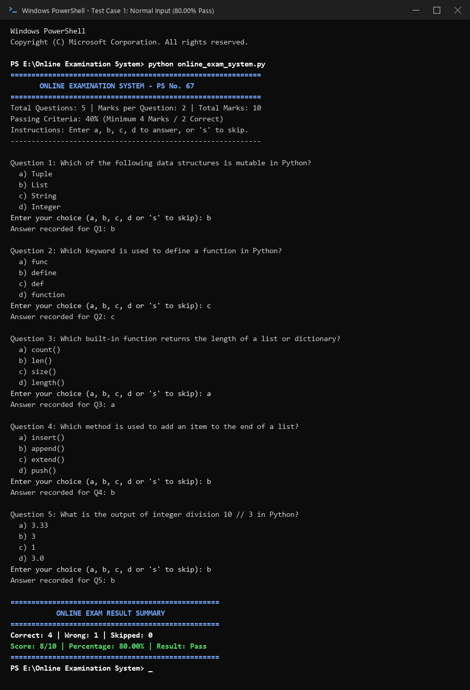
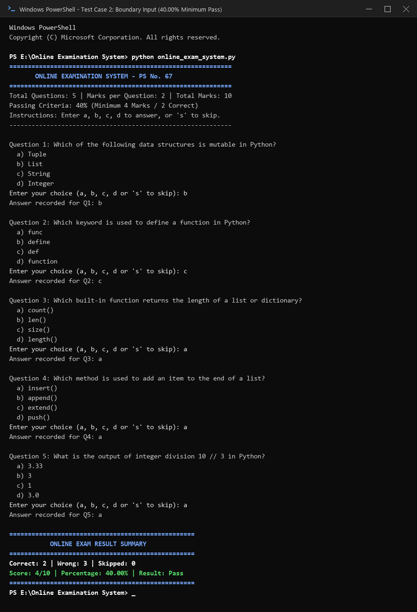
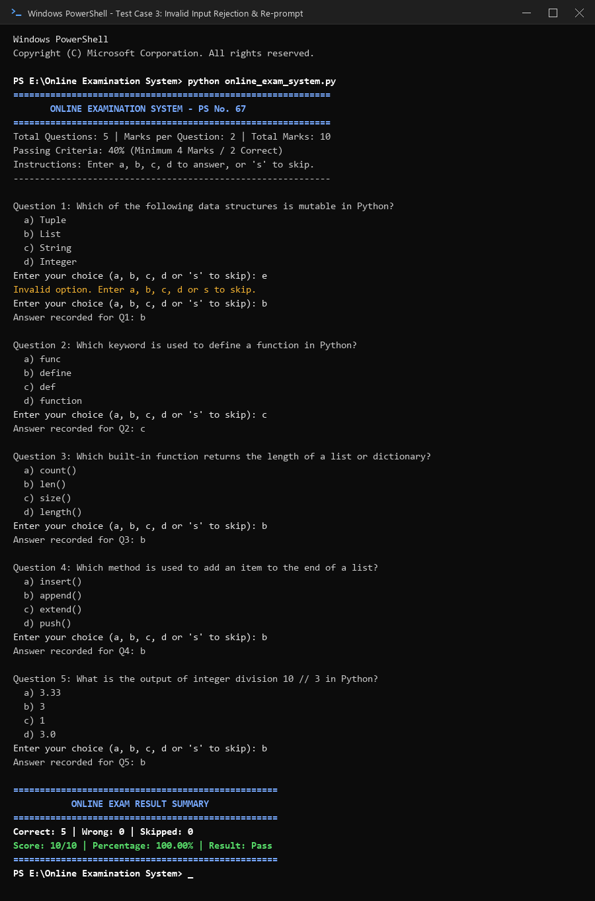
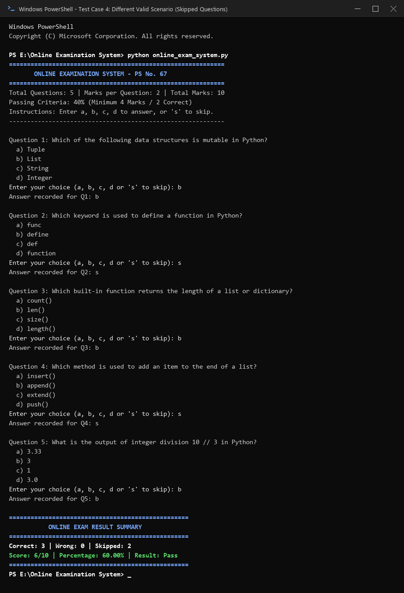

# Online Examination System (PS No. 67) - Summary Report

**Institution:** Rungta International Skills University  
**School:** School of Computer Science and Engineering  
**Program:** Bachelor of Technology - Computer Science and Engineering  
**Course:** Programming Fundamentals and Logic Building Using Python (`RU-100-01-0021`)  
**Problem Statement No.:** 67  
**Project Title:** Online Examination System  
**Author:** Ankit Kumar Modi  
**Language:** Python 3  
**Concepts:** Lists, Dictionaries, Functions, Score Calculation  

---

## 📋 Problem Statement Reference

Create a console-based online exam with multiple-choice questions. The student answers each question, may skip a question, and at the end the program calculates the score, percentage and the Pass/Fail result.

* **Language:** Python 3
* **Concepts:** Lists, Dictionaries, Functions, Score Calculation
* **Exam Parameters:** 5 MCQs (options a-d), 2 marks each, total 10 marks.
* **Passing Rule:** Pass if score is at least 40% (Minimum 4 marks / 2 correct questions).
* **Answer Key:** Q1-b, Q2-c, Q3-b, Q4-b, Q5-b.
* **Skipping Rule:** Enter `'s'` to skip a question; skipped and wrong answers get 0 marks.

---

## 🧪 Test Case 1: Normal Input (80% Pass)

### Input & Requirements
* **Input Sequence:** `b, c, a, b, b`
* **Answer Breakdown:**
  * Q1: `b` (Key: `b`) $\rightarrow$ **Correct** (+2 marks)
  * Q2: `c` (Key: `c`) $\rightarrow$ **Correct** (+2 marks)
  * Q3: `a` (Key: `b`) $\rightarrow$ **Wrong** (0 marks)
  * Q4: `b` (Key: `b`) $\rightarrow$ **Correct** (+2 marks)
  * Q5: `b` (Key: `b`) $\rightarrow$ **Correct** (+2 marks)

### Expected Console Output
```text
Correct: 4 | Wrong: 1 | Skipped: 0
Score: 8/10 | Percentage: 80.00% | Result: Pass
```

### Laptop Terminal Screenshot


### Real Terminal Transcript
```text
PS E:\Online Examination System> python online_exam_system.py
============================================================
       ONLINE EXAMINATION SYSTEM - PS No. 67
============================================================
Total Questions: 5 | Marks per Question: 2 | Total Marks: 10
Passing Criteria: 40% (Minimum 4 Marks / 2 Correct)
Instructions: Enter a, b, c, d to answer, or 's' to skip.
------------------------------------------------------------

Question 1: Which of the following data structures is mutable in Python?
  a) Tuple
  b) List
  c) String
  d) Integer
Enter your choice (a, b, c, d or 's' to skip): b
Answer recorded for Q1: b

Question 2: Which keyword is used to define a function in Python?
  a) func
  b) define
  c) def
  d) function
Enter your choice (a, b, c, d or 's' to skip): c
Answer recorded for Q2: c

Question 3: Which built-in function returns the length of a list or dictionary?
  a) count()
  b) len()
  c) size()
  d) length()
Enter your choice (a, b, c, d or 's' to skip): a
Answer recorded for Q3: a

Question 4: Which method is used to add an item to the end of a list?
  a) insert()
  b) append()
  c) extend()
  d) push()
Enter your choice (a, b, c, d or 's' to skip): b
Answer recorded for Q4: b

Question 5: What is the output of integer division 10 // 3 in Python?
  a) 3.33
  b) 3
  c) 1
  d) 3.0
Enter your choice (a, b, c, d or 's' to skip): b
Answer recorded for Q5: b

==================================================
           ONLINE EXAM RESULT SUMMARY
==================================================
Correct: 4 | Wrong: 1 | Skipped: 0
Score: 8/10 | Percentage: 80.00% | Result: Pass
==================================================
```

* **Status:** **PASS**

---

## 🧪 Test Case 2: Boundary / Minimum Input (40% Minimum Pass)

### Input & Requirements
* **Input Sequence:** `b, c, a, a, a`
* **Answer Breakdown:**
  * Q1: `b` (Key: `b`) $\rightarrow$ **Correct** (+2 marks)
  * Q2: `c` (Key: `c`) $\rightarrow$ **Correct** (+2 marks)
  * Q3: `a` (Key: `b`) $\rightarrow$ **Wrong** (0 marks)
  * Q4: `a` (Key: `b`) $\rightarrow$ **Wrong** (0 marks)
  * Q5: `a` (Key: `b`) $\rightarrow$ **Wrong** (0 marks)

### Expected Console Output
```text
Correct: 2 | Wrong: 3 | Skipped: 0
Score: 4/10 | Percentage: 40.00% | Result: Pass
```

### Laptop Terminal Screenshot


### Real Terminal Transcript
```text
PS E:\Online Examination System> python online_exam_system.py
============================================================
       ONLINE EXAMINATION SYSTEM - PS No. 67
============================================================
Total Questions: 5 | Marks per Question: 2 | Total Marks: 10
Passing Criteria: 40% (Minimum 4 Marks / 2 Correct)
Instructions: Enter a, b, c, d to answer, or 's' to skip.
------------------------------------------------------------

Question 1: Which of the following data structures is mutable in Python?
  a) Tuple
  b) List
  c) String
  d) Integer
Enter your choice (a, b, c, d or 's' to skip): b
Answer recorded for Q1: b

Question 2: Which keyword is used to define a function in Python?
  a) func
  b) define
  c) def
  d) function
Enter your choice (a, b, c, d or 's' to skip): c
Answer recorded for Q2: c

Question 3: Which built-in function returns the length of a list or dictionary?
  a) count()
  b) len()
  c) size()
  d) length()
Enter your choice (a, b, c, d or 's' to skip): a
Answer recorded for Q3: a

Question 4: Which method is used to add an item to the end of a list?
  a) insert()
  b) append()
  c) extend()
  d) push()
Enter your choice (a, b, c, d or 's' to skip): a
Answer recorded for Q4: a

Question 5: What is the output of integer division 10 // 3 in Python?
  a) 3.33
  b) 3
  c) 1
  d) 3.0
Enter your choice (a, b, c, d or 's' to skip): a
Answer recorded for Q5: a

==================================================
           ONLINE EXAM RESULT SUMMARY
==================================================
Correct: 2 | Wrong: 3 | Skipped: 0
Score: 4/10 | Percentage: 40.00% | Result: Pass
==================================================
```

* **Status:** **PASS**

---

## 🧪 Test Case 3: Invalid Input (Rejection & Re-prompt)

### Input & Requirements
* **Input Sequence for Q1:** `e` (invalid option), followed by `b` (valid option)
* **Subsequent Answers:** `c, b, b, b`

### Expected Console Output
```text
Invalid option. Enter a, b, c, d or s to skip.
Answer recorded for Q1: b
```

### Laptop Terminal Screenshot


### Real Terminal Transcript
```text
PS E:\Online Examination System> python online_exam_system.py
============================================================
       ONLINE EXAMINATION SYSTEM - PS No. 67
============================================================
Total Questions: 5 | Marks per Question: 2 | Total Marks: 10
Passing Criteria: 40% (Minimum 4 Marks / 2 Correct)
Instructions: Enter a, b, c, d to answer, or 's' to skip.
------------------------------------------------------------

Question 1: Which of the following data structures is mutable in Python?
  a) Tuple
  b) List
  c) String
  d) Integer
Enter your choice (a, b, c, d or 's' to skip): e
Invalid option. Enter a, b, c, d or s to skip.
Enter your choice (a, b, c, d or 's' to skip): b
Answer recorded for Q1: b

Question 2: Which keyword is used to define a function in Python?
  a) func
  b) define
  c) def
  d) function
Enter your choice (a, b, c, d or 's' to skip): c
Answer recorded for Q2: c

Question 3: Which built-in function returns the length of a list or dictionary?
  a) count()
  b) len()
  c) size()
  d) length()
Enter your choice (a, b, c, d or 's' to skip): b
Answer recorded for Q3: b

Question 4: Which method is used to add an item to the end of a list?
  a) insert()
  b) append()
  c) extend()
  d) push()
Enter your choice (a, b, c, d or 's' to skip): b
Answer recorded for Q4: b

Question 5: What is the output of integer division 10 // 3 in Python?
  a) 3.33
  b) 3
  c) 1
  d) 3.0
Enter your choice (a, b, c, d or 's' to skip): b
Answer recorded for Q5: b

==================================================
           ONLINE EXAM RESULT SUMMARY
==================================================
Correct: 5 | Wrong: 0 | Skipped: 0
Score: 10/10 | Percentage: 100.00% | Result: Pass
==================================================
```

* **Status:** **PASS**

---

## 🧪 Test Case 4: Different Valid Scenario (Skipped Questions)

### Input & Requirements
* **Input Sequence:** `b, s, b, s, b`
* **Answer Breakdown:**
  * Q1: `b` (Key: `b`) $\rightarrow$ **Correct** (+2 marks)
  * Q2: `s` $\rightarrow$ **Skipped** (0 marks)
  * Q3: `b` (Key: `b`) $\rightarrow$ **Correct** (+2 marks)
  * Q4: `s` $\rightarrow$ **Skipped** (0 marks)
  * Q5: `b` (Key: `b`) $\rightarrow$ **Correct** (+2 marks)

### Expected Console Output
```text
Correct: 3 | Wrong: 0 | Skipped: 2
Score: 6/10 | Percentage: 60.00% | Result: Pass
```

### Laptop Terminal Screenshot


### Real Terminal Transcript
```text
PS E:\Online Examination System> python online_exam_system.py
============================================================
       ONLINE EXAMINATION SYSTEM - PS No. 67
============================================================
Total Questions: 5 | Marks per Question: 2 | Total Marks: 10
Passing Criteria: 40% (Minimum 4 Marks / 2 Correct)
Instructions: Enter a, b, c, d to answer, or 's' to skip.
------------------------------------------------------------

Question 1: Which of the following data structures is mutable in Python?
  a) Tuple
  b) List
  c) String
  d) Integer
Enter your choice (a, b, c, d or 's' to skip): b
Answer recorded for Q1: b

Question 2: Which keyword is used to define a function in Python?
  a) func
  b) define
  c) def
  d) function
Enter your choice (a, b, c, d or 's' to skip): s
Answer recorded for Q2: s

Question 3: Which built-in function returns the length of a list or dictionary?
  a) count()
  b) len()
  c) size()
  d) length()
Enter your choice (a, b, c, d or 's' to skip): b
Answer recorded for Q3: b

Question 4: Which method is used to add an item to the end of a list?
  a) insert()
  b) append()
  c) extend()
  d) push()
Enter your choice (a, b, c, d or 's' to skip): s
Answer recorded for Q4: s

Question 5: What is the output of integer division 10 // 3 in Python?
  a) 3.33
  b) 3
  c) 1
  d) 3.0
Enter your choice (a, b, c, d or 's' to skip): b
Answer recorded for Q5: b

==================================================
           ONLINE EXAM RESULT SUMMARY
==================================================
Correct: 3 | Wrong: 0 | Skipped: 2
Score: 6/10 | Percentage: 60.00% | Result: Pass
==================================================
```

* **Status:** **PASS**

---

## 📊 Bare Minimum Requirements Compliance Matrix

| Bare Minimum Requirement | Implementation Location | Compliance Status |
|---|---|:---:|
| **1. Solution in Python 3 (one .py file) run from console** | `online_exam_system.py` runnable directly from terminal | **100% Compliant** |
| **2. Questions stored as list of dicts: `question`, `options`, `answer`** | `get_questions()` returns required list of dictionaries | **100% Compliant** |
| **3. Ask questions in loop, validate option, allow skip `'s'`** | `prompt_question_answer()` handles validation and skipping | **100% Compliant** |
| **4. Calculate counts, score, percentage, Pass/Fail via functions** | `calculate_results()` computes all metrics deterministically | **100% Compliant** |
| **5. Display result summary at the end of the exam** | `display_summary()` formats output card | **100% Compliant** |

---

**Project Status:** **COMPLETE & VERIFIED**  
**Author:** *Ankit Kumar Modi*  
**Date:** November 16, 2026
